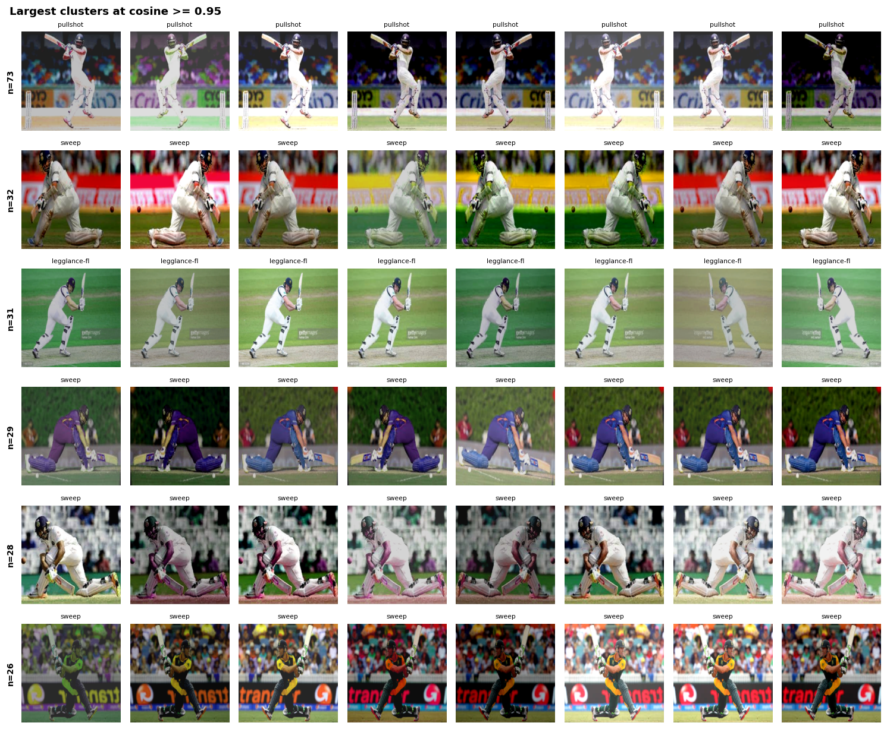
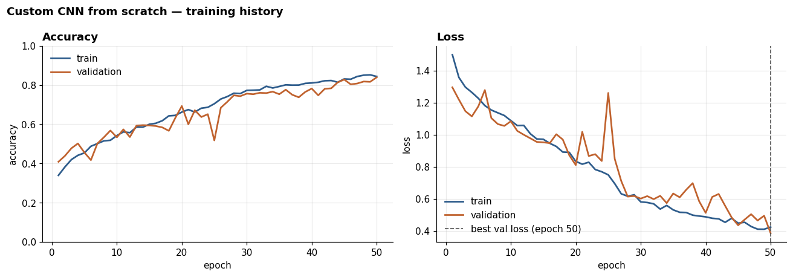
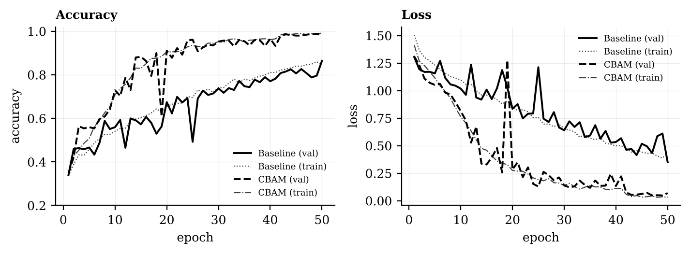
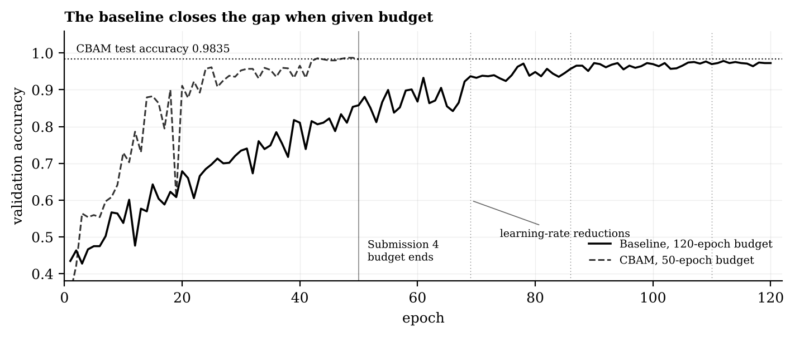
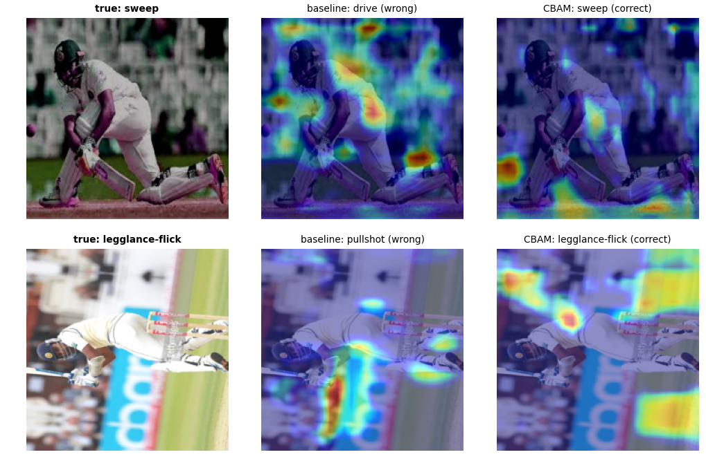

# Cricket Shot Attention CNN

Fine-grained classification of cricket batting shots from **single frames** — pretrained CNNs, a custom CNN trained from scratch, and a CBAM attention variant, evaluated under a leakage-controlled protocol.


---

## Final report

📄 **[Attention Speeds Up Convergence: A Controlled Study of CNN-Based Cricket Shot Classification](final-report/Cricket_Shot_CNN_Final_Paper.pdf)**

Rayhanul Islam, Fardeen Mohammad Fuad, Shamiha Reza Rami, Fariha Maisha — Department of Computer Science, East West University, Dhaka.

The paper brings the four submissions together around two findings:

- **Leakage audit.** Embedding clustering shows the public corpus is 41.2% redundant, where perceptual hashing reported 12.9%. The dataset's own colour-jitter augmentation is invisible to difference hashing, and 45.9% of the earlier test images had a near-duplicate in training.
- **Convergence control.** CBAM raises macro F1 from 0.8593 to 0.9836 under a shared 50-epoch budget, but the baseline alone reaches 0.9639 with 120 epochs. That recovers 84% of the gain, so the result is reported as faster convergence (39.0 vs 70.6 minutes), not a higher ceiling.

---

## Problem

Given one still frame of a batsman mid-stroke, predict which of four batting shots is being played:

| Class | Description |
|---|---|
| `drive` | Cover drive, straight drive, off drive |
| `legglance-flick` | Leg glance and flick |
| `pullshot` | Pull |
| `sweep` | Sweep |

**Why this is hard.** All four classes share the same scene grammar — one batsman, one pitch, the same kit, similar stadium backdrops. The discriminative signal is confined to body posture and bat angle, which occupy a small fraction of the frame. The model must learn to ignore the crowd, the sightscreen and the advertising boards.

**Why single frames.** Almost all prior cricket shot work is video-based and relies on temporal models (LSTM/GRU over frame sequences). This project asks how much of the task survives when that temporal signal is removed, and whether spatial attention can recover part of the gap.

---

## Dataset

| | |
|---|---|
| **Name** | Cricket Shots Dataset |
| **Source** | https://www.kaggle.com/datasets/aneesh10/cricket-shot-dataset |
| **Task** | Multi-class, single-label image classification |
| **Classes** | 4 — `drive`, `legglance-flick`, `pullshot`, `sweep` |
| **Author / year** | Aneesh Aparajit, 2022 (version 2) |
| **Images** | 4,724 (4,116 unique after duplicate grouping) |
| **Effective size** | **2,777 independent images** — see the leakage audit under [Results](#results) |
| **Licence** | **Unknown** — no licence specified; do not redistribute the images |

> **Note on construction.** This dataset was assembled from internet images and then expanded by offline augmentation. Multiple files are therefore transformations of the same source photograph. See [Known issue: duplicate leakage](#known-issue-duplicate-leakage).

**The dataset is not committed to this repository.** Download it from Kaggle, or add it as an input on a Kaggle notebook where it mounts at `/kaggle/input/cricket-shot-dataset/data`.

---

## Known issue: duplicate leakage

Because the published dataset contains offline-augmented copies of the same source images, a naive `train_test_split` places transformations of one photograph into both train and test. The model is then evaluated on pictures it has effectively already seen, and every reported metric is inflated.

This repository controls for it:

1. A 64-bit perceptual difference hash (dHash) is computed for every image.
2. Images sharing a hash are collected into **duplicate groups**.
3. The train/val/test split is made over *groups*, stratified by class — never over individual files.
4. The resulting split is frozen to [`results-data/split_manifest.csv`](results-data/) and reused unchanged by every later submission.

**Measured result:** 345 duplicate groups covering 953 images; **608 redundant copies (12.9%)**; largest group holds 10 copies of one photograph; zero groups span more than one class. Effective dataset size is 4,116, not 4,724. Estimated accuracy inflation under a naive split: 2–3 percentage points.

Note this is a *lower bound* — exact perceptual hashing does not catch rotated or cropped duplicates.

**Update (embedding audit).** [`00_leakage_audit.ipynb`](notebooks/) clusters images by CNN embedding similarity and finds **41.2% redundancy**, not 12.9%. The author's augmentation was colour jitter, which a difference hash cannot see. Submissions 3 and 4 therefore use [`results-data/clean_split_manifest.csv`](results-data/), split over embedding clusters.

This matters beyond tidiness. A 2025 standardized re-implementation study found that cricket shot models originally reporting 96%, 99.2% and 93% accuracy scored 46.0%, 55.6% and 57.7% when re-run under a consistent protocol ([Kang 2025](https://arxiv.org/abs/2510.09187)). Uncontrolled splits are a plausible contributor.

---

## Submissions

| # | Deliverable | Notebook | Status |
|---|---|---|---|
| 1 | Dataset, EDA, related work | [`01_eda_and_related_work.ipynb`](notebooks/) | ✅ Complete |
| 2 | 3+ pretrained models, frozen vs fine-tuned | [`02_pretrained_models.ipynb`](notebooks/) | ✅ Complete |
| 0 | Leakage audit (embedding clustering, clean split) | [`00_leakage_audit.ipynb`](notebooks/) | ✅ Complete |
| 3 | Custom CNN from scratch | [`03_custom_cnn.ipynb`](notebooks/) | ✅ Complete |
| 4 | CNN + CBAM attention | [`04_cnn_attention.ipynb`](notebooks/) | ✅ Complete |
| — | Convergence control (supplementary) | [`05_convergence_control.ipynb`](notebooks/) | ✅ Complete |

From Submission 2 onward, every notebook reports accuracy, precision, recall, F1, a confusion matrix, and training/testing time.

---

## Results

*Populated as submissions complete.*

| Model | Mode | Accuracy | Macro-F1 | Epochs | Train | ms/img |
|---|---|---|---|---|---|---|
| **EfficientNetB0** | **fine-tuned** | **0.9972** | **0.9973** | 24 | 10.6 m | 8.73 |
| DenseNet121 | fine-tuned | 0.9972 | 0.9972 | 24 | 17.5 m | 14.87 |
| ResNet50 | fine-tuned | 0.9945 | 0.9944 | 29 | 19.5 m | 9.75 |
| ResNet50 | frozen | 0.9750 | 0.9752 | 40 | 12.0 m | 9.72 |
| EfficientNetB0 | frozen | 0.9598 | 0.9602 | 40 | 6.6 m | 9.18 |
| DenseNet121 | frozen | 0.9098 | 0.9103 | 40 | 13.3 m | 16.47 |
| **Custom CNN** | **from scratch** | **0.8514** | **0.8515** | 50 | 29.9 m | 2.93 |
| Custom CNN (S4 baseline) | from scratch | 0.8589 | 0.8593 | 50 | 29.3 m | 3.31 |
| Custom CNN, 120 epochs | from scratch | 0.9640 | 0.9639 | 120 | 70.6 m | 3.31 |
| **Custom CNN + CBAM** | **from scratch** | **0.9835** | **0.9836** | 50 | 39.0 m | 4.11 |

⚠️ **The Custom CNN rows are measured on the clean split; the pretrained rows above them are on the contaminated split.** They are not directly comparable — see [`reports/Submission3_Report.pdf`](reports/Submission3_Report.pdf).

Fine-tuning improved macro F1 for all three backbones, mean **+0.0478**. No run overfit.


> ### ⚠️ The pretrained accuracies are inflated — this is now measured, not suspected
>
> An embedding-based audit ([`00_leakage_audit.ipynb`](notebooks/)) found that the
> dataset author's augmentation was **colour jitter**, which perceptual hashing cannot
> detect. One photograph appears **73 times**.
>
> | | |
> |---|---|
> | Raw files | 4,724 |
> | Exact-hash groups (Submission 1) | 4,116 — 12.9% redundant |
> | **Embedding clusters (cos ≥ 0.95)** | **2,777 — 41.2% redundant** |
> | Clusters spanning two classes | 0 |
> | **Submission 2 test images contaminated** | **331 of 721 = 45.9%** |
>
> 
>
> Each row above is one photograph under different colour transformations.
>
> Supporting evidence from Submission 2: DenseNet121 **frozen** reached 91.0% with only
> 4,100 trainable parameters, which a linear probe on fixed ImageNet features could only
> do if test images sit very close to training images in feature space.
>
> Submissions 3 and 4 use the corrected split from `results-data/clean_split_manifest.csv`.
> Contamination is proven and large, but with only 2 errors in 721 predictions it does
> not by itself explain Submission 2's 99.7% — see the report for the honest limits of
> that conclusion.

### Submission 3 — custom CNN from scratch

Four conv blocks, 1,206,756 trainable parameters, 50 epochs on the clean split.

| | |
|---|---|
| Test accuracy | **0.8514** |
| Macro F1 | **0.8515** |
| Train–val gap | +0.0042 (no overfitting) |
| Best epoch | 50 of 50 — **still improving at the budget limit** |



**The per-class ordering matches Submission 2's mean ordering** — sweep easiest, then
pullshot, legglance-flick, drive — across four architectures and two splits, which points
to a property of the data rather than of any model.

**The hardest pair is `drive` ↔ `legglance-flick` (40 of 99 errors),** confirming the
visual prediction made in Submission 1. Submission 2's best model made only 2 errors, too
few to identify a hardest pair.

### Submission 4 — attention, and what the gain measures

CBAM added to each of the four conv blocks. Nothing else changed: same split, same
seed, same hyperparameters, same 50-epoch budget.

| | Baseline | + CBAM | Change |
|---|---|---|---|
| Accuracy | 0.8589 | **0.9835** | +0.1246 |
| Macro F1 | 0.8593 | **0.9836** | +0.1243 |
| Errors (of 666) | 94 | 11 | −83 |
| Trainable parameters | 1,206,756 | 1,229,452 | +22,696 (+1.9%) |
| Training time | 29.3 m | 39.0 m | +9.7 m |

The gain of 12.43 pp clears the 3.04 pp detection threshold by a factor of four, and most
of it lands on the pairs Submission 3 identified as hard: `drive`↔`legglance-flick`
31→3, `drive`↔`pullshot` 22→3, `legglance-flick`↔`pullshot` 9→0.



#### ⚠️ Most of that gain was convergence speed, not capacity

The curves above show one converged model and one that ran out of epochs. CBAM
plateaus near epoch 30; the baseline is still climbing at 50, with a train−val
accuracy gap of **−0.0163**, which is underfitting rather than a model that has learned
all it can.

[`05_convergence_control.ipynb`](notebooks/) retrains **the baseline only** with a
120-epoch budget, with the verdict rule fixed before the run.

| | Macro F1 | Epochs | Wall clock | Errors |
|---|---|---|---|---|
| Baseline, 50 epochs | 0.8593 | 50 | 29.3 m | 94 |
| Baseline, 120 epochs | **0.9639** | 120 | 70.6 m | 24 |
| CNN + CBAM, 50 epochs | 0.9836 | 50 | 39.0 m | 11 |



**The baseline recovered 10.46 of the 12.43 pp — 84% of the gain.** The residual
1.97 pp falls below the 3.04 pp threshold, so this experiment cannot resolve it.

The supported claim is therefore about efficiency, not accuracy:

> Under a fixed 50-epoch budget CBAM improves macro F1 by 12.43 pp. That improvement is
> predominantly faster convergence: CBAM reaches equivalent accuracy in 39.0 minutes
> where the unmodified baseline requires 70.6. This experiment finds no evidence that
> attention raises the achievable ceiling of this architecture.

Early stopping never fired in the 120-epoch run, but `ReduceLROnPlateau` annealed the
learning rate from 1e-3 to 8.1e-6 and the best validation loss came at epoch 112, so the
run is converged in the sense that matters.

#### A note on run-to-run variation

The Submission 3 run and the Submission 4 baseline are the same architecture, split,
seed and budget, yet scored 0.8515 and 0.8593 macro F1 — a spread of **0.78 pp** from
GPU non-determinism alone. That is close to the 0.70 pp run-to-run term assumed in the
significance threshold, and a reminder that single-seed differences under ~3 pp should
not be over-read.

#### Grad-CAM is not conclusive



Four corrected images were inspected in the notebook (two are shown above). CBAM
tightened onto the batsman in some and attended to crowd and hoardings in others while
still classifying correctly. All 88 corrected images were not scored, so no proportion
is claimed. "Attention suppresses background" is not a sufficient account of the
mechanism.

---

## Repository layout

```
cricket-shot-attention-cnn/
├── README.md
├── LICENSE
├── requirements.txt
├── .gitignore
├── final-report/
│   └── Cricket_Shot_CNN_Final_Paper.pdf
├── notebooks/
│   ├── 00_leakage_audit.ipynb
│   ├── 01_eda_and_related_work.ipynb
│   ├── 02_pretrained_models.ipynb
│   ├── 03_custom_cnn.ipynb
│   ├── 04_cnn_attention.ipynb
│   └── 05_convergence_control.ipynb  # supplementary to Submission 4
├── results-data/
│   ├── split_manifest.csv        # hash-grouped split (Submissions 1–2)
│   ├── clean_split_manifest.csv  # embedding-cluster split (Submissions 3–4) — do not regenerate
│   ├── submission2_results.csv
│   ├── submission2_per_class_f1.csv
│   ├── submission3_results.csv
│   ├── submission3_per_class.csv
│   ├── submission4_results.csv
│   ├── submission4_per_class.csv
│   └── convergence_control.{csv,json}
├── reports/
│   ├── Submission1_Report.pdf / .tex
│   ├── Submission2_Report.pdf / .tex
│   ├── Submission3_Report.pdf / .tex
│   ├── Submission4_Report.pdf
│   └── figures/                  # sample frames used in the report
└── results/
    └── figures/                  # Submission 2+ plots
```

---

## How to run

1. Open a notebook from `notebooks/` on Kaggle (File → Import Notebook → GitHub link).
2. Add the dataset as an input: **+ Add Input** → `aneesh10/cricket-shot-dataset`.
3. **Run All.** No extra installs needed. Notebook 02 trains six CNNs, so turn on a GPU first (Settings → Accelerator → GPU T4); it takes about 80 minutes. Notebooks 03–05 also need `results-data/clean_split_manifest.csv` added as an input; on a GPU they take about 30, 70 and 75 minutes.

To run locally instead, `pip install -r requirements.txt` and set `DATA_DIR` to the dataset's `data/` folder.

---

## Experimental protocol

Held fixed across all submissions so that comparisons are attributable:

| Setting | Value |
|---|---|
| Split | 70 / 15 / 15, grouped by duplicate identity, stratified by class |
| Random seed | 42 |
| Input size | 224 × 224 |
| Normalisation | ImageNet channel statistics |
| Augmentation | ±10° rotation, ±20% brightness/contrast, random resized crop (0.8–1.0) |
| **Horizontal flip** | **Not applied** — see below |

> **Why no horizontal flip.** It is the augmentation most people apply reflexively, and it is wrong here. A sweep and a leg glance are defined partly by which side of the body the ball is played to. Mirroring the image changes the correct label.

The Submission 4 comparison holds architecture, split, seed, optimizer, learning rate, batch size and epoch budget constant, varying **only** the presence of the attention module, so any measured difference is attributable to attention.

---

## Related work

Six papers surveyed in full in the Submission 1 notebook and report. Summary of the landscape:

- The field is **overwhelmingly video-based**. Of the surveyed work, only Dey & Biswas (2024) and Islam et al. (2019) operate on single images, and the latter classifies bowlers rather than shots.
- **Reported accuracies are unreliable.** See [Known issue](#known-issue-duplicate-leakage) above.
- **Attention appears but is never isolated** — prior work introduces attention alongside other architectural changes, so its individual contribution cannot be separated. Submission 4 isolates it.

Key references:

1. Sen, Deb, Dhar & Koshiba (2021), *Sensors* — [CricShotClassify](https://pmc.ncbi.nlm.nih.gov/articles/PMC8072636)
2. Kang (2025) — [Modern Deep Learning Approaches for Cricket Shot Classification](https://arxiv.org/abs/2510.09187)
3. Dey & Biswas (2024), *Int. J. Engineering* — [Shot-ViT](https://www.ije.ir/article_195819.html)
4. Islam, Hassan & Khan (2019) — [A CNN-based approach to classify cricket bowlers based on their bowling actions](https://arxiv.org/abs/1909.01228)

---

## Licence

Code in this repository is MIT licensed. The dataset is **not** covered by that licence — see its Kaggle page for terms before redistributing any part of it.
