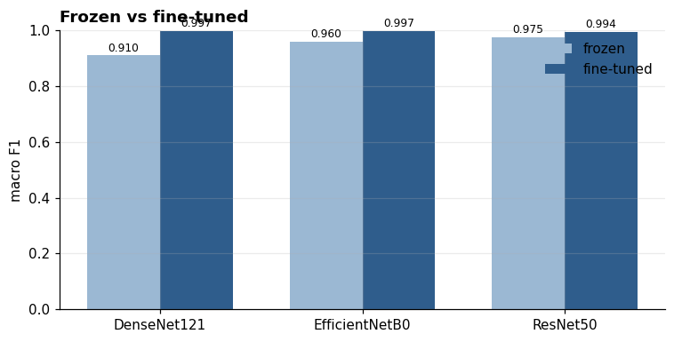
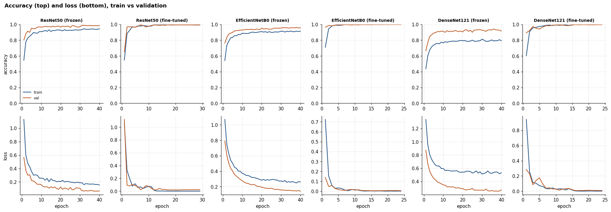

# Cricket Shot Attention CNN

Fine-grained classification of cricket batting shots from **single frames** — pretrained CNNs, a custom CNN trained from scratch, and a CBAM attention variant, evaluated under a leakage-controlled protocol.


---

## Problem

Given one still frame of a batsman mid-stroke, predict which of four batting shots is being played:

| Class | Description |
|---|---|
| `drive` | Cover drive, straight drive, off drive |
| `legglance-flick` | Leg glance and flick |
| `pullshot` | Pull |
| `sweep` | Sweep |

**Why this is hard.** All four classes share the same scene grammar — one batsman, one pitch, the same kit, similar stadium backdrops. The discriminative signal is confined to body posture and bat angle, which occupy a small fraction of the frame. The model must learn to ignore the crowd, the sightscreen and the advertising boards.

**Why single frames.** Almost all prior cricket shot work is video-based and relies on temporal models (LSTM/GRU over frame sequences). This project asks how much of the task survives when that temporal signal is removed, and whether spatial attention can recover part of the gap.

---

## Dataset

| | |
|---|---|
| **Name** | Cricket Shots Dataset |
| **Source** | https://www.kaggle.com/datasets/aneesh10/cricket-shot-dataset |
| **Task** | Multi-class, single-label image classification |
| **Classes** | 4 — `drive`, `legglance-flick`, `pullshot`, `sweep` |
| **Author / year** | Aneesh Aparajit, 2022 (version 2) |
| **Images** | 4,724 (4,116 unique after duplicate grouping) |
| **Licence** | **Unknown** — no licence specified; do not redistribute the images |

> **Note on construction.** This dataset was assembled from internet images and then expanded by offline augmentation. Multiple files are therefore transformations of the same source photograph. See [Known issue: duplicate leakage](#known-issue-duplicate-leakage).

**The dataset is not committed to this repository.** Download it from Kaggle, or add it as an input on a Kaggle notebook where it mounts at `/kaggle/input/cricket-shot-dataset/data`.

---

## Known issue: duplicate leakage

Because the published dataset contains offline-augmented copies of the same source images, a naive `train_test_split` places transformations of one photograph into both train and test. The model is then evaluated on pictures it has effectively already seen, and every reported metric is inflated.

This repository controls for it:

1. A 64-bit perceptual difference hash (dHash) is computed for every image.
2. Images sharing a hash are collected into **duplicate groups**.
3. The train/val/test split is made over *groups*, stratified by class — never over individual files.
4. The resulting split is frozen to [`artifacts/split_manifest.csv`](artifacts/) and reused unchanged by every later submission.

**Measured result:** 345 duplicate groups covering 953 images; **608 redundant copies (12.9%)**; largest group holds 10 copies of one photograph; zero groups span more than one class. Effective dataset size is 4,116, not 4,724. Estimated accuracy inflation under a naive split: 2–3 percentage points.

Note this is a *lower bound* — exact perceptual hashing does not catch rotated or cropped duplicates.

This matters beyond tidiness. A 2025 standardized re-implementation study found that cricket shot models originally reporting 96%, 99.2% and 93% accuracy scored 46.0%, 55.6% and 57.7% when re-run under a consistent protocol ([Kang 2025](https://arxiv.org/abs/2510.09187)). Uncontrolled splits are a plausible contributor.

---

## Submissions

| # | Deliverable | Notebook | Status |
|---|---|---|---|
| 1 | Dataset, EDA, related work | [`01_eda_and_related_work.ipynb`](notebooks/) | ✅ Complete |
| 2 | 3+ pretrained models, frozen vs fine-tuned | [`02_pretrained_models.ipynb`](notebooks/) | ✅ Complete |
| 3 | Custom CNN from scratch | `03_custom_cnn.ipynb` | ⚪ Not started |
| 4 | CNN + CBAM attention | `04_cnn_with_attention.ipynb` | ⚪ Not started |

From Submission 2 onward, every notebook reports accuracy, precision, recall, F1, a confusion matrix, and training/testing time.

---

## Results

*Populated as submissions complete.*

| Model | Mode | Accuracy | Macro-F1 | Epochs | Train | ms/img |
|---|---|---|---|---|---|---|
| **EfficientNetB0** | **fine-tuned** | **0.9972** | **0.9973** | 24 | 10.6 m | 8.73 |
| DenseNet121 | fine-tuned | 0.9972 | 0.9972 | 24 | 17.5 m | 14.87 |
| ResNet50 | fine-tuned | 0.9945 | 0.9944 | 29 | 19.5 m | 9.75 |
| ResNet50 | frozen | 0.9750 | 0.9752 | 40 | 12.0 m | 9.72 |
| EfficientNetB0 | frozen | 0.9598 | 0.9602 | 40 | 6.6 m | 9.18 |
| DenseNet121 | frozen | 0.9098 | 0.9103 | 40 | 13.3 m | 16.47 |
| Custom CNN | scratch | — | — | — | — | — |
| Custom CNN + CBAM | scratch | — | — | — | — | — |

Fine-tuning improved macro F1 for all three backbones, mean **+0.0478**. No run overfit.





> ### ⚠️ These accuracies are inflated
>
> The dataset author states the images were augmented before release. The exact-hash
> deduplication in Submission 1 removed 608 identical copies (12.9%), but a **rotated or
> cropped** copy produces a completely different hash and was not caught — so those
> variants are still split across train and test.
>
> Supporting evidence: DenseNet121 **frozen** reached 91.0% with only 4,100 trainable
> parameters. A linear probe on fixed ImageNet features cannot learn anything
> cricket-specific; reaching 91% means test images sit very close to training images in
> feature space.
>
> An embedding-based similarity audit is the next step. The *relative* findings
> (fine-tuning effect, hardest/easiest class, timings) are unaffected; the *absolute*
> numbers should not be quoted without this caveat.

---

## Repository layout

```
cricket-shot-attention-cnn/
├── README.md
├── LICENSE
├── requirements.txt
├── .gitignore
├── notebooks/
│   ├── 01_eda_and_related_work.ipynb
│   ├── 02_pretrained_models.ipynb
│   ├── 03_custom_cnn.ipynb          # planned
│   └── 04_cnn_with_attention.ipynb  # planned
├── artifacts/
│   ├── split_manifest.csv        # frozen split — written by notebook 01, do not regenerate
│   ├── submission2_results.csv
│   └── submission2_per_class_f1.csv
├── reports/
│   ├── Submission1_Report.pdf
│   ├── Submission1_Report.tex
│   ├── Submission2_Report.pdf
│   ├── Submission2_Report.tex
│   └── figures/                  # sample frames used in the report
└── results/
    └── figures/                  # Submission 2+ plots
```

---

## How to run

1. Open a notebook from `notebooks/` on Kaggle (File → Import Notebook → GitHub link).
2. Add the dataset as an input: **+ Add Input** → `aneesh10/cricket-shot-dataset`.
3. **Run All.** No extra installs needed. Notebook 02 trains six CNNs, so turn on a GPU first (Settings → Accelerator → GPU T4); it takes about 80 minutes.

To run locally instead, `pip install -r requirements.txt` and set `DATA_DIR` to the dataset's `data/` folder.

---

## Experimental protocol

Held fixed across all submissions so that comparisons are attributable:

| Setting | Value |
|---|---|
| Split | 70 / 15 / 15, grouped by duplicate identity, stratified by class |
| Random seed | 42 |
| Input size | 224 × 224 |
| Normalisation | ImageNet channel statistics |
| Augmentation | ±10° rotation, ±20% brightness/contrast, random resized crop (0.8–1.0) |
| **Horizontal flip** | **Not applied** — see below |

> **Why no horizontal flip.** It is the augmentation most people apply reflexively, and it is wrong here. A sweep and a leg glance are defined partly by which side of the body the ball is played to. Mirroring the image changes the correct label.

The Submission 4 comparison holds architecture, split, seed, optimizer, learning rate, batch size and epoch budget constant, varying **only** the presence of the attention module, so any measured difference is attributable to attention.

---

## Related work

Six papers surveyed in full in the Submission 1 notebook and report. Summary of the landscape:

- The field is **overwhelmingly video-based**. Of the surveyed work, only Dey & Biswas (2024) and Islam et al. (2019) operate on single images, and the latter classifies bowlers rather than shots.
- **Reported accuracies are unreliable.** See [Known issue](#known-issue-duplicate-leakage) above.
- **Attention appears but is never isolated** — prior work introduces attention alongside other architectural changes, so its individual contribution cannot be separated. Submission 4 isolates it.

Key references:

1. Sen, Deb, Dhar & Koshiba (2021), *Sensors* — [CricShotClassify](https://pmc.ncbi.nlm.nih.gov/articles/PMC8072636)
2. Kang (2025) — [Modern Deep Learning Approaches for Cricket Shot Classification](https://arxiv.org/abs/2510.09187)
3. Dey & Biswas (2024), *Int. J. Engineering* — [Shot-ViT](https://www.ije.ir/article_195819.html)
4. Islam, Hassan & Khan (2019) — [A CNN-based approach to classify cricket bowlers based on their bowling actions](https://arxiv.org/abs/1909.01228)

---

## Licence

Code in this repository is MIT licensed. The dataset is **not** covered by that licence — see its Kaggle page for terms before redistributing any part of it.
